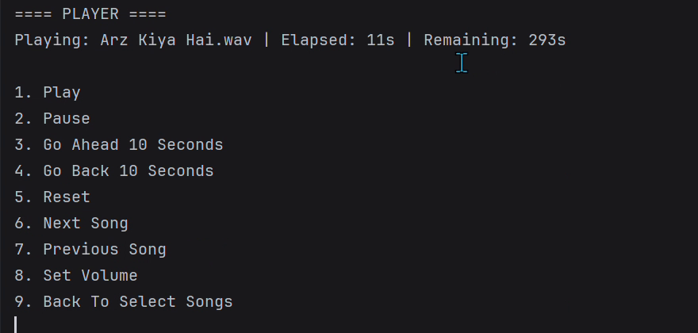

# Java Terminal Music Player

A personal Java project for playing local WAV audio and managing playlists from a terminal. It combines Java Sound playback with text-file persistence and a menu-driven interface.

## Demonstration



A cropped frame from the owner's existing recording. It illustrates the original terminal interface, not a fresh end-to-end test of this revision. No audio is included. [Frame provenance](docs/DEMONSTRATION.md).

## What it implements

- Play, pause, restart, seek, next/previous track, and volume controls.
- Create, rename, delete, and edit playlists; maintain a favourites list.
- Case-insensitive song-name prefix search.
- Separate classes for menus, playback, playlist persistence, and file reading.

## Build and run

Install a JDK with `javac` and `java` available. From the repository root:

```powershell
javac -d build Main.java Menu.java MusicPlayer.java PlaylistManager.java FileHandler.java
java -cp build Main
```

Create a local `Songs` directory and place WAV files you own or may use there. Add one filename per line to **`songs.txt`**, for example `sample.wav`. Filenames are resolved relative to `Songs/`; retain exact spelling and case. Audio files are intentionally excluded from Git.

Existing playlist files under `Playlists/` contain song filenames, not bundled audio. Replace sample entries with your own files. Run from the repository root so relative paths resolve correctly. Audio format and volume support depend on the Java Sound mixer available on the machine.

## Design

| Class | Responsibility |
|---|---|
| `Main` | Main menu and playlist/search navigation |
| `Menu` | Terminal menu output |
| `MusicPlayer` | Java Sound `Clip` lifecycle and playback controls |
| `PlaylistManager` | Playlist registration and text-file updates |
| `FileHandler` | Song-list loading and prefix search |

Playlist metadata is stored in `playlists.txt`, with one text file per playlist under `Playlists/`. This is a local, single-user application, not a streaming service or database-backed backend.

## Validation

See [validation notes](docs/VALIDATION.md) for checks actually run and remaining limitations. No online deployment is provided. Only WAV formats accepted by Java Sound are supported; MP3 playback is not claimed.

## Author

Syed Muhammad Rayyan Hassan — personal experimental project.
